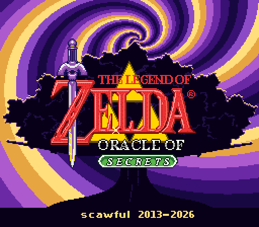
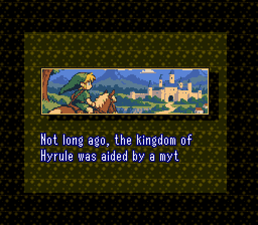
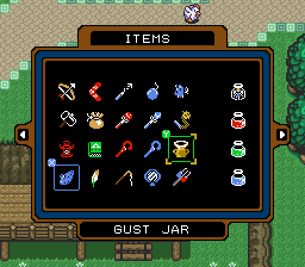
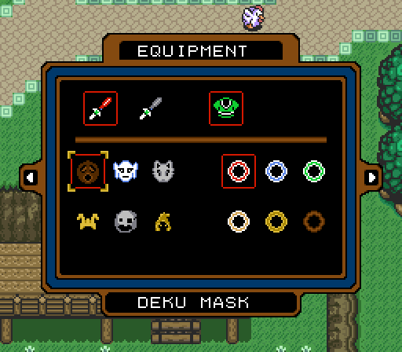
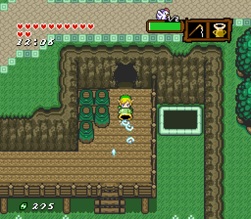
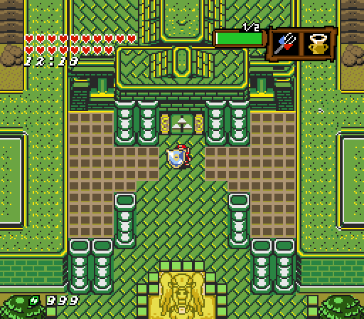
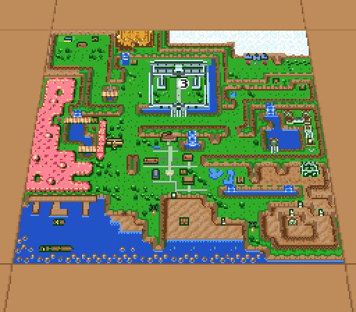
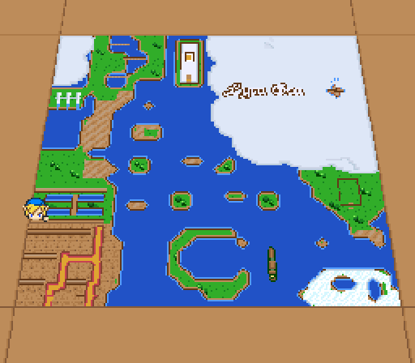

# The Legend of Zelda: Oracle of Secrets

A full-scale *A Link to the Past* ROM hack featuring original overworlds, dungeons, custom bosses, mask transformations, expanded items, custom music, and a day/night system. Learn more at [halext.org](https://halext.org/labs/Oracle).

## Highlights

- **Expanded Overworlds & Regions:** Kalyxo (with day/night cycle), Eon Abyss (GBC-styled dark realm), East Kalyxo, Lyra Sea (sailable boat + 6-stop Song of Soaring), and Sky Islands.
- **Mask Transformations:** Deku, Zora, Wolf, Bunny, Stone, Garo, and Minish forms with quick-swap bindings.
- **Custom Items & Menu Overhaul:** Minish Cap-style Gust Jar, Portal Rod, Switch Hook / Goldstar, Bombchus, Fishing Rod, Ocarina songs, and X/Y item bindings.
- **Custom Bosses, NPCs & Soundtrack:** Original bosses, living villages, and custom SNES N-SPC arrangements.

## Screenshots

| Title Screen | Intro Storybook |
|---|---|
|  |  |

| Menu v5: Items (Dual X/Y Bind) | Menu v5: Equipment & Masks |
|---|---|
|  |  |

| Wayward Village (Gust Jar) | Eon Abyss (GBC Dark World) |
|---|---|
|  |  |

| Kalyxo World Map | Lyra Sea & East Kalyxo Map |
|---|---|
|  |  |

## Start Here

| I want to... | Go to |
|---|---|
| Build the ROM | `Scripts/Build/build_rom.sh 168` (base `Roms/oos168.sfc` → patched `Roms/oos168x.sfc`) |
| Package a `.bps` beta patch | `Scripts/Build/beta_patch.sh` (diffs against vanilla US ALTTP 1.0) |
| Edit rooms, maps, graphics, text | Open `Oracle-of-Secrets.yaze` in [yaze](https://github.com/scawful/yaze) |
| Look up RAM/SRAM, flags, tables | `Docs/Technical/` (`Flag_Ledger.md`, `MemoryMap.md`) |
| Read dungeon & world references | `Docs/World/` |

### Repository Layout

- **Game source:** `Oracle_main.asm`, `Config/`, `Core/`, `Dungeons/`, `Items/`, `Masks/`, `Menu/`, `Music/`, `Overworld/`, `Sprites/`, `Util/`. Feature flags live in `Util/macros.asm` (generated into `Config/feature_flags.asm` via `Scripts/Build/set_feature_flags.py`).
- **Build data:** `Data/` (dialogue tables, custom collision, graphics manifests, debug checkpoints), `Docs/Dev/Planning/*.json`.
- **Scripts:** Build, generation, validation, and emulator helpers (`Scripts/README.md`).
- **Tests:** Automated unit and compiled 65816 test suites (`Tests/`).

## Quick Build

```bash
Scripts/Build/build_rom.sh 168      # assemble patched ROM (Roms/oos168x.sfc)
Scripts/Build/oos-quick.sh          # fast build + Mesen2 reload
Scripts/Build/oos-verify.sh         # build + reload + validation suite
Scripts/Build/z3dk_safe_smoke.sh    # isolated z3asm smoke build
```

ROM naming: `Roms/oos<VERSION>.sfc` is the unpatched base (edit target); `Roms/oos<VERSION>x.sfc` is the Asar-patched output for emulator testing only. Never edit the `x` ROM directly.

## Hook Tagging (Optional)

`z3asm` infers each hook's kind, target, and name from assembled code (`Scripts/Build/build_rom.sh 168 --asar=z3asm` writes `Roms/hooks.json`). Add an `@hook` comment on an `org` line only to override those values or document ABI widths:

```asm
org $02C0C3 ; @hook name=Overworld_SetCameraBounds expected_m=16 expected_x=8
```

Supported `@hook` fields: `name`, `kind`, `target`, `module`, `note`, `expected_m`, `expected_x`, `expected_exit_m`, `expected_exit_x`, `skip_abi`, `abi`.

## Z3DK Config

- `z3dk.toml`: Oracle of Secrets main entry (`Oracle_main.asm`).
